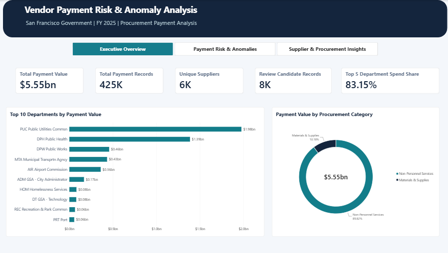
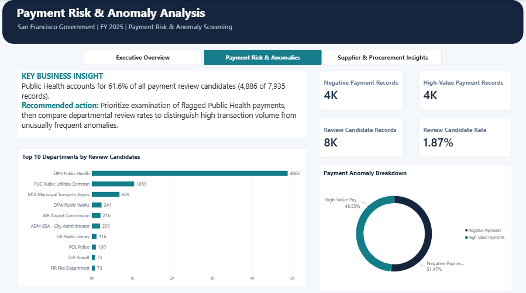
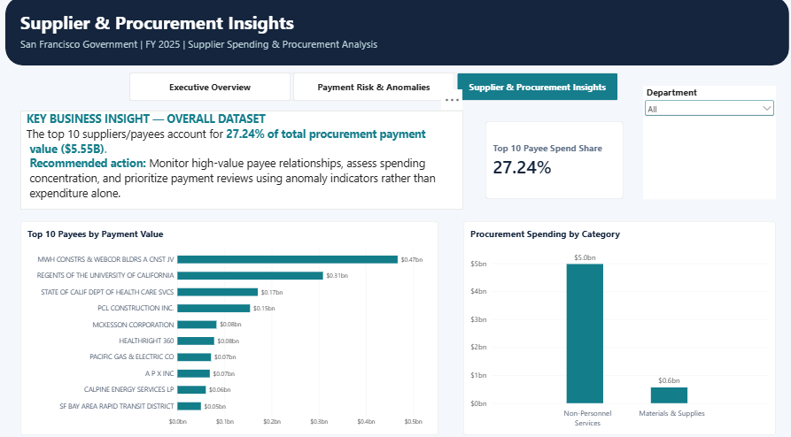

# Vendor Payment Risk & Anomaly Analysis

**An end-to-end procurement analytics portfolio project | PostgreSQL · Python · Pandas · Power BI · DAX**

> **The business question:** Where is government procurement spending concentrated, and which payment records merit closer review?

Analyzed **425,044 FY 2025 San Francisco government voucher records**, representing **$5.55 billion** in recorded payment value, to develop transparent review indicators and an interactive three-page Power BI report. This project focuses on **Materials & Supplies** and **Non-Personnel Services**; results should not be interpreted as representing all government spending.

**[Explore the Power BI dashboard](Vendor_Payment_Risk_Dashboard.pbix)** · **[Read detailed findings](findings.md)**

## Dashboard preview



*Executive Overview: payment value, record counts, department concentration, and procurement category distribution.*

### Explore all three pages

| Executive Overview | Payment Risk & Anomalies | Supplier & Procurement Insights |
|---|---|---|
|  |  |  |
| Spending overview and department ranking | Review flags, candidate rates, and departmental distribution | Leading payees, category spending, and department filtering |

## At a glance

| KPI | Result |
|---|---:|
| Analyzed voucher records | **425,044** |
| Total recorded payment value | **$5,546,152,415.31** |
| Distinct supplier and other payee labels | **5,552** |
| Negative-value records | **4,084** |
| High-value records | **3,851** |
| Review candidate records | **7,935** |
| Review candidate rate | **1.87%** |
| Top 5 departments' share of payment value | **83.15%** |
| Top 10 payees' share of payment value | **27.24%** |

> **Interpretation:** Review candidates are **rule-based screening flags**, **not confirmed fraud**. Negative values can represent reversals or other legitimate accounting adjustments.

## Business problem

Large public payment datasets are difficult to review record by record. Finance and procurement teams need a way to:

1. See where recorded payment value is concentrated across departments and payees.
2. Identify transactions that deserve a second look using explainable rules.
3. Prioritize review work without treating unusual accounting entries as proof of misconduct.
4. Explore results through an accessible, interactive dashboard.

## Data and scope

**Source:** [San Francisco Open Data](https://data.sfgov.org/) — *Vendor Payments (Vouchers)*, FY 2025.

| Stage | Scope |
|---|---|
| Source extract | 515,694 rows; 32 columns |
| Procurement-focused analytical extract | 425,044 rows; 36 columns |
| Included `Character` categories | Materials & Supplies; Non-Personnel Services |
| Excluded from repository | Original ~2.4 GB CSV and processed ~183 MB CSV |

The source field **`Supplier & Other Non-Supplier Payees`** includes more than suppliers. Accordingly, this documentation uses **payees** when describing rankings or distinct names.

Voucher rows may represent accounting allocations rather than unique cash transfers. The dashboard summarizes **records**, not necessarily distinct disbursements.

## Analytical workflow

```text
SF Open Data — FY 2025 Vendor Payments (Vouchers)
                    |
                    v
          PostgreSQL exploration
          and cleaning view
                    |
                    v
          Python / Pandas checks
          and analytical extract
                    |
                    v
          Rule-based review flags
          and KPI definitions
                    |
                    v
         Power BI model + DAX measures
                    |
                    v
      Three-page interactive dashboard
                    |
                    v
       Findings and review priorities
```

The repository includes the Power BI report and available Python validation scripts. SQL source files and a fully automated reproduction pipeline should only be described as available after they have been added and checked.

## Dashboard walkthrough

### 01 — Executive Overview


Provides a high-level picture of payment value and record volume, the departments with the greatest payment value, procurement category distribution, and concentration among the five highest-spending departments.

### 02 — Payment Risk & Anomalies


Summarizes negative-value and high-value record flags, overall review candidate rate, and departments with the highest *counts* of flagged records. These counts are not equivalent to department-specific flag rates.

### 03 — Supplier & Procurement Insights


Ranks payees by payment value, compares the two procurement categories, and provides a **Department** slicer for exploration. The **27.24% top-ten payee concentration** finding refers to the unfiltered dataset; interactive filtering can change displayed KPIs.

## Key findings and decisions they support

### 1. Spending is concentrated in a small number of departments

The five highest-spending departments account for **83.15%** of the analyzed payment value. This provides a starting point for spend monitoring, but high expenditure is not inherently suspicious.

**Action:** Review spending concentration alongside each department's budget, responsibilities, and transaction mix.

### 2. A small share of records meets the review criteria

**7,935 of 425,044 records (1.87%)** were flagged for review, comprising **4,084 negative-value** and **3,851 high-value** records in the analyzed extract.

**Action:** Use these flags to build a review queue; inspect supporting documentation and accounting context before reaching conclusions.

### 3. Public Health contributes the most flagged records

**DPH Public Health** accounts for **4,886 review candidate records**, or approximately **61.6% of all flagged records**.

**Action:** Compare department-specific flag rates and transaction volumes before deciding where reviews are most urgent. A large raw count may partly reflect a large department's activity.

### 4. The largest payees represent a meaningful share of spend

The **top ten payees account for 27.24%** of analyzed payment value.

**Action:** Monitor major payee relationships and assess exposure or dependency, while distinguishing spending concentration from anomaly risk.

## Review-indicator methodology

The dashboard uses explainable indicators for **negative payment values** and **high-value payment records**. The resulting review-candidate counts reflect the project's screening logic, **not a validated fraud-detection model**.

- **Negative values:** May be refunds, corrections, reversals, or other accounting adjustments.
- **High-value records:** Merit contextual review; size alone does not establish impropriety.
- **Direct Payments:** A legitimate payment classification, not automatic evidence of a missing purchase order.
- **Voucher granularity:** Multiple accounting rows can relate to the same underlying business event.

The precise high-value threshold and transformation logic should be checked against the project's source scripts before documenting them as reproducible rules.

## Technology stack

| Tool | Purpose |
|---|---|
| PostgreSQL 17 / SQL | Querying and preparing source voucher data |
| Python / Pandas | Inspection, validation, and analytical processing |
| Power BI | Interactive report design and data exploration |
| DAX | Payment KPIs, review-candidate measures, and spend concentration |

## Repository guide

```text
Vendor-Payment-Risk-Analysis/
├── README.md
├── Vendor_Payment_Risk_Dashboard.pbix
├── findings.md
├── inspect_data.py
├── check_csv_integrity.py
├── .gitignore
└── assets/
    └── dashboard/
        ├── executive-overview.png
        ├── payment-risk-anomalies.png
        └── supplier-procurement-insights.png
```

**Local only:** `Data/` contains large source and processed CSV files that are excluded from Git tracking. Additional SQL scripts, dependency specifications, or documentation may be added once verified.

## How to explore the project

1. Review the dashboard screenshots above to understand the three analytical perspectives.
2. Download `Vendor_Payment_Risk_Dashboard.pbix` and open it with **Power BI Desktop**.
3. If the report requests local data files, update its data-source path to your own processed dataset. The large CSV files are **not** included in this repository.
4. Inspect `inspect_data.py`, `check_csv_integrity.py`, and `findings.md` for the available checks and observations.
5. To reproduce the dataset preparation from scratch, obtain the FY 2025 voucher data from San Francisco Open Data. A fully executable, end-to-end setup is **not yet bundled** with this repository.

## Limitations and next steps

- **Screening, not adjudication:** Flags cannot confirm fraud, duplicate payments, or policy violations.
- **Subset scope:** Only two procurement categories are analyzed.
- **Data granularity:** Voucher rows are not necessarily unique bank transfers.
- **Payee labels:** Names may include non-supplier payees and may require normalization.
- **Comparability:** Departmental counts should be normalized by volume before comparing risk.
- **Reproducibility:** Publish verified SQL scripts, dependency versions, and documented high-value thresholds in a future update.

Potential enhancements include department-level flag rates, payee normalization, time-series monitoring, and documented validation of screening thresholds.

---

**Portfolio project:** SQL · Python · Business Intelligence · Procurement Analytics


